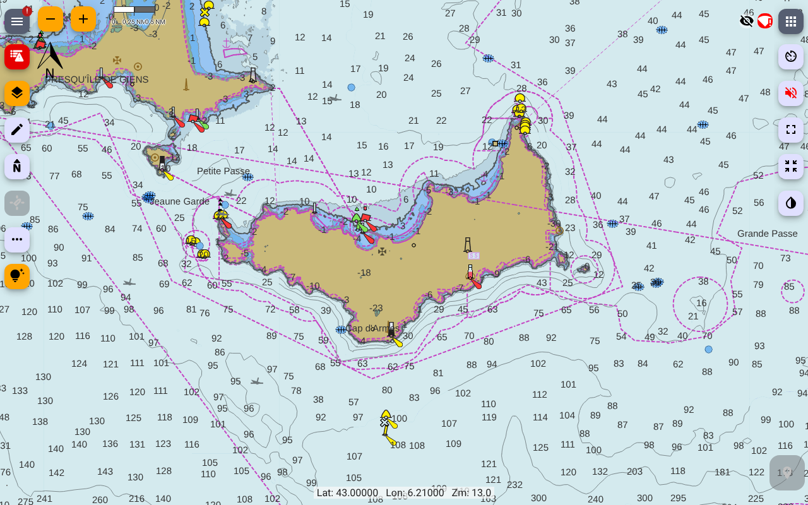
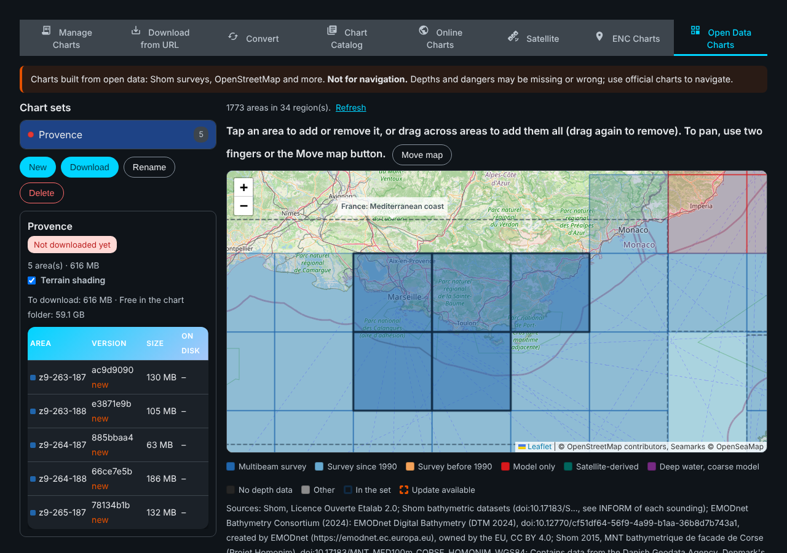
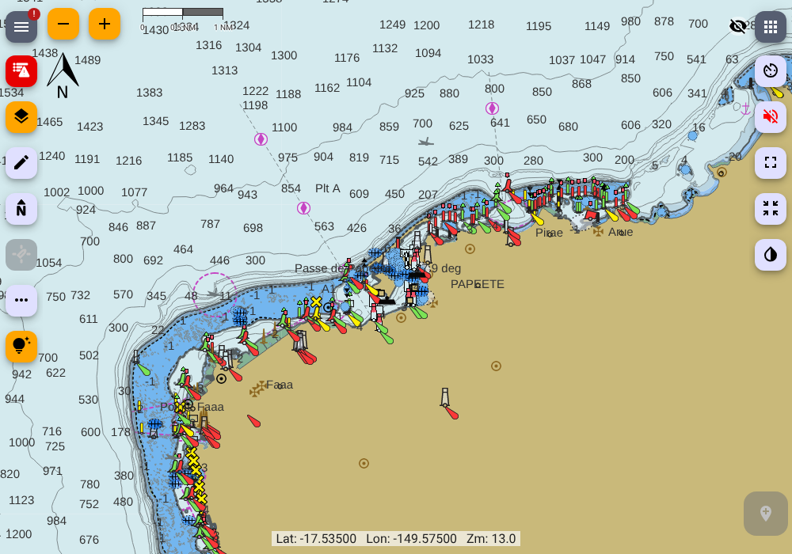
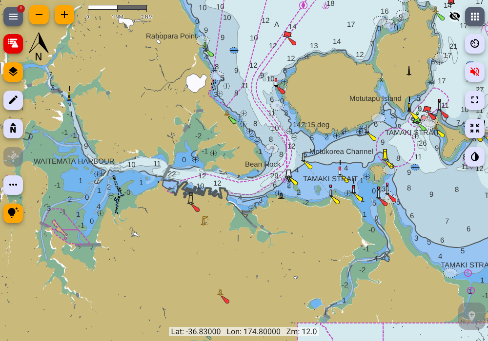
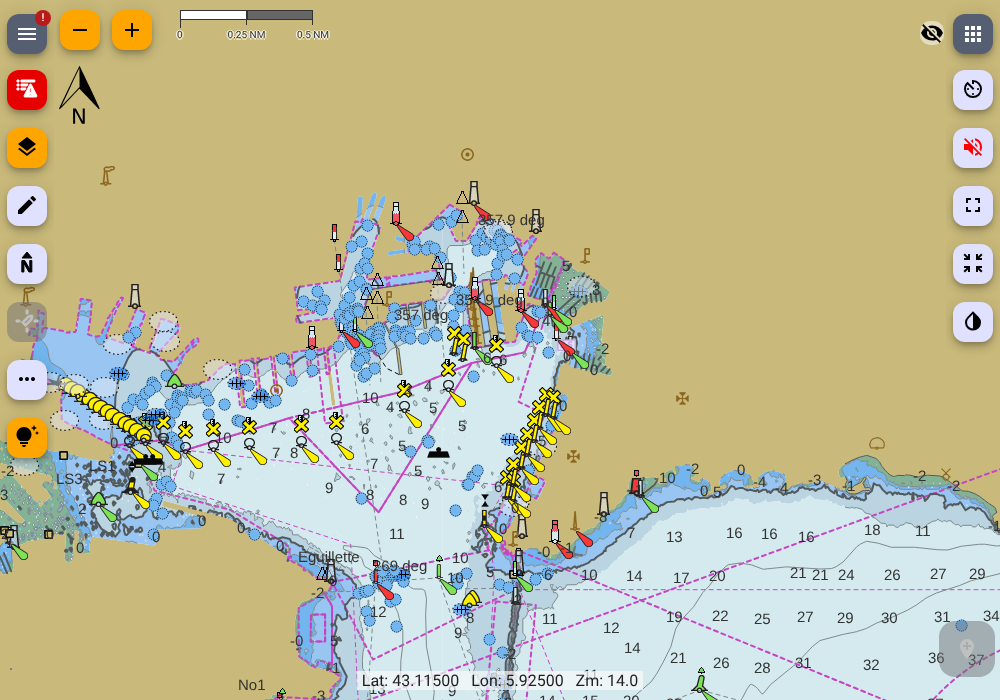
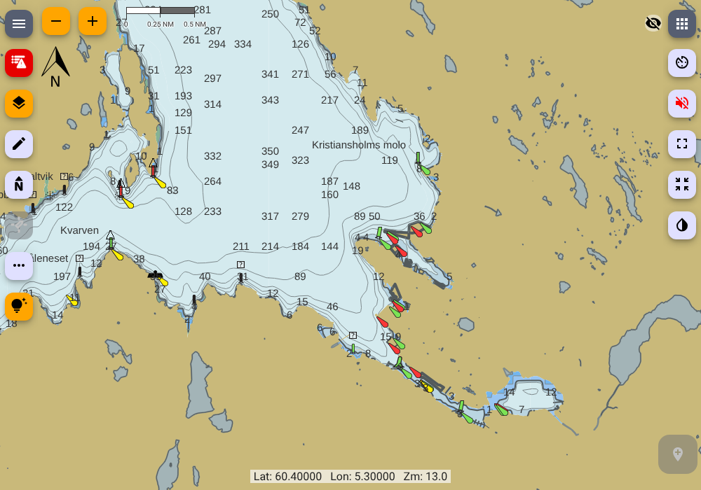

# Open Data Charts

Free nautical charts for your Signal K chart plotter, built from open data:
depths, depth contours, soundings, buoys and lights, land and terrain, for
coasts in Europe, the Mediterranean, Australia, New Zealand and the French
overseas territories. You pick the areas you sail on a map, they are
downloaded to your boat, and they work offline in
[Freeboard-SK](https://github.com/SignalK/freeboard-sk).

> [!WARNING]
> **Not for navigation.** These charts are compiled automatically from open
> data that its publishers themselves mark "not for navigation". Depths,
> dangers and aids to navigation may be missing, outdated or wrong. They are
> no substitute for official charts.

## What you get

- **Vector charts** (S-57 style) that Freeboard-SK draws like an official
  ENC: depth areas and contours, soundings, buoys, beacons and lights, wrecks
  and rocks, land, harbours and place names, sharp at every zoom up to
  harbour level.
- **Terrain shading** of hills and mountains on land, as a second chart you
  can switch on or off.
- **Only the areas you need.** The coast is cut into areas of about 0.7°
  (20 to 40 NM wide, depending on latitude). You download only the ones you sail, and an
  area takes from a few MB to a few hundred MB.
- **Small updates.** When an area is rebuilt from newer data, only that area
  is downloaded again.
- **Free.** No account, no subscription.

## Where

| Area | Regions | Depths from |
|------|---------|-------------|
| France | Channel and North Sea coast (with England's south coast), Atlantic coast, Mediterranean coast, Corsica | Shom surveys and models |
| French overseas | New Caledonia, French Polynesia, Wallis and Futuna, Réunion, Mayotte, Guadeloupe, Martinique, Saint-Martin and Saint-Barthélemy, French Guiana, Saint-Pierre and Miquelon | Shom surveys and models |
| British Isles | Isles of Scilly and Land's End, England and Wales with the Irish Sea, Scotland with Northern Ireland and North East England, Ireland's Atlantic coast, Cork, the Shannon Estuary and Galway Bay | EMODnet, INFOMAR in Irish waters |
| North Sea and Baltic | Dutch Wadden Sea, German North Sea, German Baltic, Denmark | Rijkswaterstaat, BSH and WSV, Danish Depth Model |
| Norway | Southern Norway, Oslofjord to Stad | Kartverket |
| Atlantic islands and Iberia | Galicia, Portugal and the Gulf of Cadiz, Canary Islands, Madeira | EMODnet, Instituto Hidrográfico |
| Mediterranean | Spain, the Balearics, Morocco and Algeria; Liguria; Sardinia; Tuscany and the northern Adriatic; central Italy to Albania; Sicily, Malta and the Ionian Sea | EMODnet, ICGC on the Catalan coast |
| Australia | Kimberley and Top End, Torres Strait, Great Barrier Reef, New South Wales, Victoria and Tasmania | Geoscience Australia, NSW marine lidar and multibeam |
| New Zealand | North, South and Stewart Islands | LINZ chart data |
| Canada | British Columbia: the Salish Sea and Desolation Sound, the west coast of Vancouver Island, the Central Coast, Haida Gwaii, Prince Rupert and Dixon Entrance | Canadian Hydrographic Service (NONNA) |

New regions are added regularly. The Open Data Charts tab (below) always
shows what is available right now. [docs/sources.md](docs/sources.md)
describes each region's data in detail.

## Getting the charts onto your boat

You need a Signal K server and
[Charts Provider Simple](https://github.com/dirkwa/signalk-charts-provider-simple),
the plugin that downloads the charts and serves them to your plotter.

1. In the Signal K admin page, open **Appstore**, search for **Charts
   Provider Simple** and install it, then restart the server when asked.
2. Open **Webapps → Charts Provider Simple** and go to the **Open Data
   Charts** tab.
3. Press **New** and give your chart set a name, for example the cruising
   area or the season's plan.
4. Tap the areas you want on the map, or drag across several to add them
   all. Tapping an area in the set takes it out again, and so does dragging
   across areas that are all in the set already. The set shows its download
   size and the free space on the server.
5. Press **Download**, and confirm once that these charts are not for
   navigation. The plugin builds one chart from all the areas of the set.

The areas on the map are coloured by the best depth data they hold:

| Colour | Depths come from |
|--------|------------------|
| Dark blue | Multibeam surveys, the most detailed |
| Light blue | Surveys since 1990 |
| Orange | Surveys before 1990 |
| Red | A bathymetric model only (a depth grid, no individual soundings) |
| Green | Satellite-derived depths, charted as rough bands (0-2, 2-5 and over 5 m) |
| Purple | Deep water from a coarse global model |
| Black | No depth data: water no survey or model covers, charted as unsurveyed |

A newer kind of data the tab does not know yet shows as "Other" until you
update the plugin.

When an area has been rebuilt, the set shows **Update available**; press
**Update** to download only the areas that changed. Nothing is downloaded
until you press a button.

## Showing them in Freeboard-SK

Open Freeboard-SK, press the layers button (**Routes, Waypoints, Notes**),
open **Charts** and tick your chart set. It is listed with "(not for
navigation)" after its name. Tick the "terrain shading" chart too if you want
hills on land shaded.

## How good are the depths?

As good as the data behind them, which differs a lot from place to place:

- In French waters soundings come from Shom's surveys, and in New Zealand
  from LINZ's charts.
- Elsewhere depths come from a **model**, a grid of depths from a few metres
  to about 115 m apart near the coast (250 m in places off south-east
  Australia), and about 460 m in deep water far offshore. Narrow channels, rocks and wrecks smaller than the grid may be
  missing. Depth numbers taken from a model say so in their details.
- Reef flats and lagoons in the tropics come from satellite images and are
  charted only in rough bands, set on the shallow side.
- Depths are on the lowest astronomical tide (LAT) or the local chart
  datum, like official charts. Around Corsica and along the Catalan coast
  they are on mean sea level, a decimetre or two above chart datum where
  the tide is only a few tens of centimetres. Norway's are on its own chart
  datum, at or up to 0.3 m below LAT.
- Buoys, beacons and lights come from Shom in French waters, from LINZ's
  charts in New Zealand and from OpenSeaMap volunteers elsewhere, and can lag
  behind changes at sea.

Always check against official charts and what you see.

## More pictures

| | |
|---|---|
|  |  |
| Papeete, Tahiti: Shom surveys | Auckland: LINZ chart data |
|  |  |
| Toulon harbour: Shom seamarks and surveys | Bergen: Kartverket's seabed model |

## For developers

### Using the charts in another plotter

The index of all published areas is public:

    https://dirkwa.github.io/open-data-charts/open-data-index.json

Each area is an MBTiles file with S-57 vector tiles. The index lists every
area's coverage, data quality, version and checksum; its format and
compatibility policy are in [docs/index-format.md](docs/index-format.md),
with a JSON Schema in [schema/](schema/open-data-index.schema.json).

### How it is built

GitHub Actions build the charts from the sources' own downloads:

- Every week a workflow mirrors the regions' Shom surveys, each reduced to
  the shoalest sounding per cell of one global grid.
- Every day another workflow takes one region in turn, works out which of
  its areas (units, z9 Web-Mercator tiles) have new inputs, builds only
  those, uploads them to the region's release and republishes the index. A
  unit's version is a hash of everything it is built from, so an unchanged
  unit is never rebuilt or downloaded again.
- Units are built on a shared grid with a margin around each one, so
  neighbouring units meet without seams.

[docs/pipeline.md](docs/pipeline.md) has notes and measurements,
[docs/sources.md](docs/sources.md) the data of each region, and
[AGENTS.md](AGENTS.md) the code.

### Contributing

New regions and open data sources are welcome; see
[CONTRIBUTING.md](CONTRIBUTING.md).

## Licences

The charts are published under the Open Database License (ODbL) 1.0 and
carry the attribution of their sources, listed in
[LICENSE-DATA.md](LICENSE-DATA.md). The code is Apache-2.0
([LICENSE](LICENSE)).
